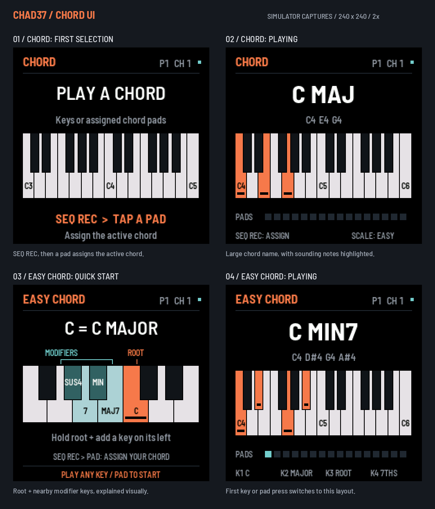

# Chad37

A MIDI controller firmware for the M-Vave SMK-37, with Chordcade's Easy Chord on the keys and chords on the 16 pads.
It has no internal sound. Built on [fm1-base](https://github.com/charlesvestal/fm1-base) and
[felucca-bsp](https://github.com/hugelton/felucca-bsp), forked from [Erik37](https://github.com/genkigenki/erik37).
The name is a nod to Erik37 and short for CHord pAD; it was Chordpad37 until 2026-11-07.

**Status: in use on an SMK-37 Elite; not released.** Keys, pads (velocity and pressure), knobs and faders in two banks,
wheels, pedal and buttons go out over USB, Bluetooth and the TRS jack, on the stock V016 map except the faders (CC
20–27) and knobs K7–K16 (absolute, CC 54–55 and 102–109). CHORD and SCALE modes put Easy Chord on the keys and
chords on the pads, with pad assignment, LATCH, voicings, auto-strum and an arpeggiator; 8 presets are saved on the
keyboard. The Pro and MKE-P37 builds have never been installed.

## Chord mode

Press **CHORD** for a large chord name and a piano keyboard highlighting the sounding notes, including generated
chord tones and voicings. To assign the active chord to a pad, press **SEQ REC**, then tap the pad.

**CHORD** works as a three-way switch: the first press is CHORD, the second **Easy Chord**, the third turns chord
modes off. Easy Chord plays the chord you press (C is C major, whatever the key); in Easy Chord, **SCALE** opens and
closes the page that sets its voicing (K3). On entering Easy Chord, a quick diagram explains how a root key and nearby
modifier keys choose the chord. The first key or pad press switches to the regular chord display.



The preview shows simulator captures enlarged 2×; this UI update has not yet been tested on the keyboard.

## Before installing

- Capture what stock V016 sends in `docs/stock-midi-map.md`. You can't do this later without going back to stock.
- Take a full flash backup: [docs/flash-backup.md](docs/flash-backup.md), after `02-update-and-recovery.md` in
  [fm1-to-smk37](https://github.com/genkigenki/fm1-to-smk37).
- The first install clears stock settings. M-Vave's updater returns to stock, which then rebuilds them.

## Building

Tests, on a Mac or Linux with a C compiler and Python 3:

```bash
sh app/tests/run_tests.sh
```

Firmware, on Linux or WSL with JieLi's toolchain (`base/tools/get_toolchain.sh`), the AC79 SDK, and Python 3 with Pillow and NumPy:

```bash
./build.sh
```

Each model has its own package in `build/chad37/` (`chad37-smk37.fwsc` for SMK-37 Pro, `chad37-smk37-elite.fwsc` for SMK-37 Elite, `chad37-smk37-mke.fwsc` for MKE-P37). Install the package matching your model with:

```bash
python3 base/tools/fm1_install.py build/chad37/chad37-smk37-elite.fwsc
```

## Licence

MPL-2.0. See [LICENSING.md](LICENSING.md).
