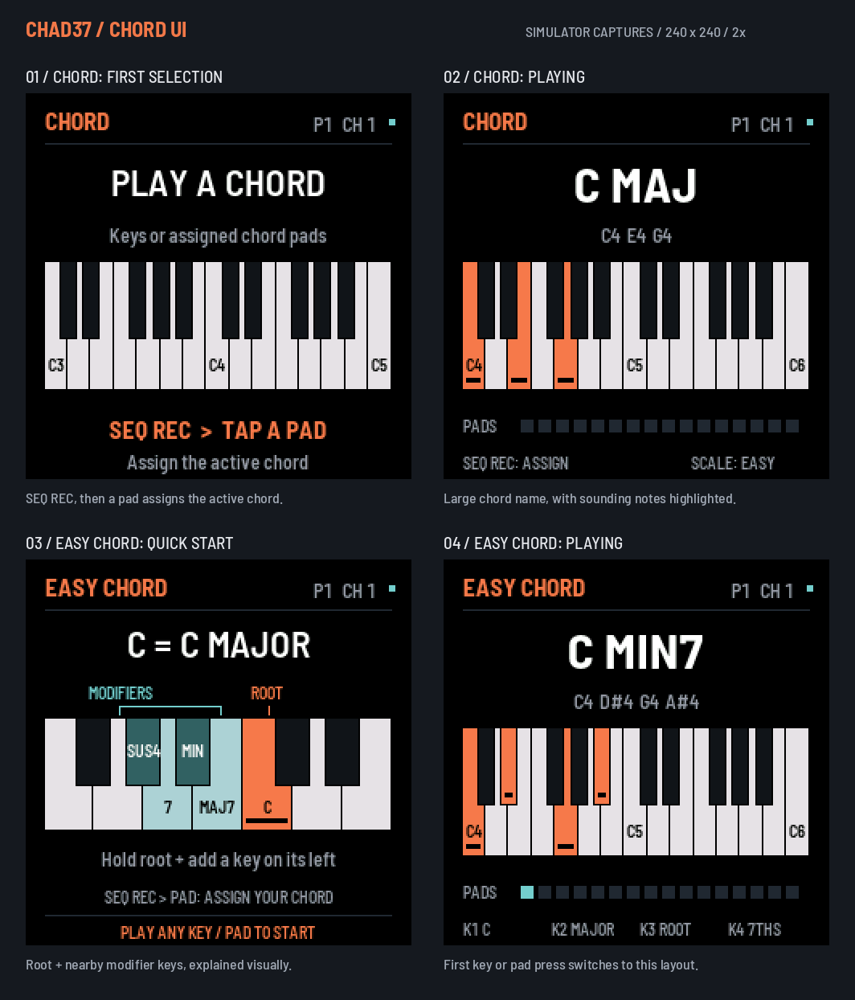

<p align="center">
  
</p>

<h1 align="center">Chad37</h1>

<p align="center"><b>Chord-pad MIDI controller firmware for the M-Vave SMK-37</b></p>

Chad37 turns the SMK-37 into a pure MIDI controller. It makes no sound of its own: every key, pad, knob and fader
plays your synth, DAW or app. That leaves the firmware to do one job well: send clean, predictable MIDI, fast.

- **Controls that behave.** The stock firmware's quirks are gone. Knobs K7–K16 sent relative values, which most
  synths read as a two-position switch. The faders sat on the sustain, portamento, sostenuto and soft-pedal CCs, so
  fader 1 held notes like a sustain pedal and wouldn't MIDI-learn. In Chad37 every knob sends an absolute 0–127, and
  the faders use CCs the MIDI standard leaves free (20–27).
- **Low latency, wired or wireless.** Tested on Windows, macOS and iOS, over a USB cable and Bluetooth MIDI.
  Bluetooth stays connected and keeps up with the cable. The TRS MIDI jack sends the same messages.
- **Chord mode.** Play any chord on the keys and assign it to a pad. There are 16 pads per bank and 16 banks, with
  voicings, strum and latch. Easy Chord plays full chords from a single key.
- **Scale mode.** Pick a key and a scale, and the pads fill themselves with the chords that belong in it: triads on
  the bottom row, 7ths or 9ths on the top. The white keys play only notes in the scale.
- **Arpeggiator.** Hold, swing, tap tempo and a 16-step rhythm of notes, accents and rests, tapped in on the pads.
  It follows MIDI clock.
- **More:** 8 saved presets, pad velocity and pressure, two knob and fader
  banks, and big on-screen feedback as you play.

**Status:** version 0.2, in daily use on an SMK-37 Elite and tested by a user on an SMK-37 Pro. The MKE-P37 build has
never been installed.

Built on [fm1-base](https://github.com/charlesvestal/fm1-base) and
[felucca-bsp](https://github.com/hugelton/felucca-bsp), and forked from
[Erik37](https://github.com/genkigenki/erik37). The name is a nod to Erik37 and short for CHord pAD.

## Main view

Turn a knob or move a fader on the main view and it shows big over the screen's middle: a dial or a fader moving with
it, with its name, value, CC and channel. It closes 1.5 seconds after the last move. The other pages and the chord
view keep the short message in the header instead.

## Chord mode

Press **CHORD** for a large chord name and a piano keyboard highlighting the sounding notes, including generated
chord tones and voicings. To assign the active chord to a pad, press **SEQ REC**, then tap the pad. Press **SEQ REC**
a second time for ERASE: pads with a chord blink orange, and each pad you tap is cleared. A third press turns it off.

The pads' chords come in **16 banks**, shared by all presets. In CHORD and Easy Chord, **<** and **>** pick the bank.
Press **<** and **>** together to delete the bank's chords; the screen asks first, and pressing both again confirms
(one arrow keeps it). Hold **PATCH** to see pads 1–8 lit by preset: white for the current one, red for presets 1 and 2
and any you've selected, green for one never used.

**CHORD** works as a three-way switch: the first press is CHORD, the second **Easy Chord**, the third turns chord
modes off. Easy Chord plays the chord you press (C is C major, whatever the key); in Easy Chord, **SCALE** opens and
closes the page that sets its voicing (K3). On entering Easy Chord, a quick diagram explains how a root key and nearby
modifier keys choose the chord. The first key or pad press switches to the regular chord display.



## Scale mode

Press **SCALE**, then set the key with K1 and the scale with K2 (major, the minors, the modes and the pentatonics).
The white keys play only notes in the scale, starting from the key on C, and the black keys are muted. The pads fill
with the scale's chords: triads on degrees I to VII and the octave across the bottom row, and 7ths or 9ths across the
top (K4). K3 sets the voicing, and the tonic pads light brighter.

## Arpeggiator

Press **ARP** to arpeggiate held keys or chord pads: Up, Down, Up/Down, Random or Chord (whole chords in turn), at
1/4, 1/8, 1/16 or 1/8T, over one to three octaves, on the internal clock or following MIDI clock. K6–K8 set the
gate, swing and the pattern's length.

- **Hold:** press **LATCH** and the chord keeps playing after you let go. Play a new chord to replace it.
- **Rhythm:** on the ARP page, press **SEQ REC** and the 16 pads become the pattern's steps. Tap a pad to make its
  step an accent, tap again for a rest, and again for a plain note. The pads light up with the pattern and a white
  playhead.
- **Swing:** from straight to a heavy shuffle, on the internal clock or MIDI clock.
- **Tap tempo:** tap **SEQ** in time, and the arp follows.

## Installing

**[Install from your browser](https://superqix.github.io/chad37/)**: plug the keyboard in by USB, open the page in Chrome or Edge, and press
Install. It finds your model and picks the right package, with nothing to set up. You can go back to M-Vave's firmware
at any time. The [install guide](docs/install.md) has the details, and a command-line installer for those who prefer
it. The [user guide](https://superqix.github.io/chad37/manual/) covers every control, mode, and setting in detail
(also [here on GitHub](docs/manual.md)).

## Building from source

Tests, on a Mac or Linux with a C compiler and Python 3:

```bash
sh app/tests/run_tests.sh
```

Firmware, on Linux or WSL with JieLi's toolchain (`base/tools/get_toolchain.sh`), the AC79 SDK, and Python 3 with Pillow and NumPy:

```bash
./build.sh
```

Each model has its own package in `build/chad37/` (`chad37-smk37.fwsc` for SMK-37 Pro, `chad37-smk37-elite.fwsc` for SMK-37 Elite, `chad37-smk37-mke.fwsc` for MKE-P37). Install the package matching your model with:

```bash
python3 base/tools/fm1_install.py build/chad37/chad37-smk37-elite.fwsc
```

The web installer is `site/index.html`, and the site also carries the user guide as a page. `tools/make_site.py`
builds the site from a release's packages and `docs/manual.md`, and
`.github/workflows/pages.yml` publishes it to GitHub Pages each time a release is published:

```bash
python3 tools/make_site.py build/chad37 0.2 build/site
```

## Licence

MPL-2.0. See [LICENSING.md](LICENSING.md).

## Sponsors

<p align="center">
  <a href="https://chordcade.com/">
    <picture>
      <source media="(prefers-color-scheme: dark)" srcset="docs/sponsors/chordcade-dark.png">
      
    </picture>
  </a>
  &nbsp;&nbsp;&nbsp;&nbsp;&nbsp;&nbsp;
  <a href="https://ponywolf.com/">
    <picture>
      <source media="(prefers-color-scheme: dark)" srcset="docs/sponsors/ponywolf-dark.png">
      
    </picture>
  </a>
</p>

<p align="center">
  <a href="https://chordcade.com/">Chordcade</a>: play chords with the game controller you already own.
  <br>
  <a href="https://ponywolf.com/">Ponywolf</a>: retro gaming, reimagined.
</p>
